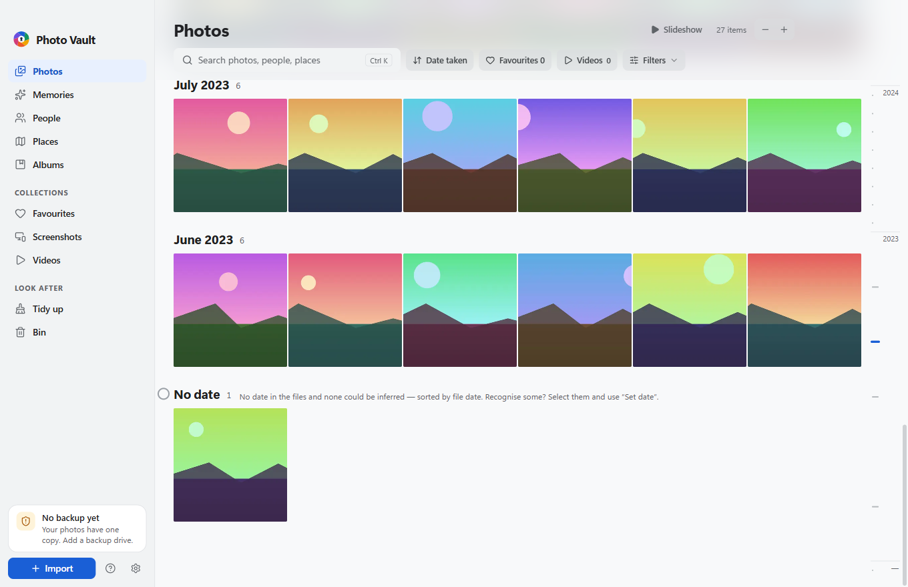
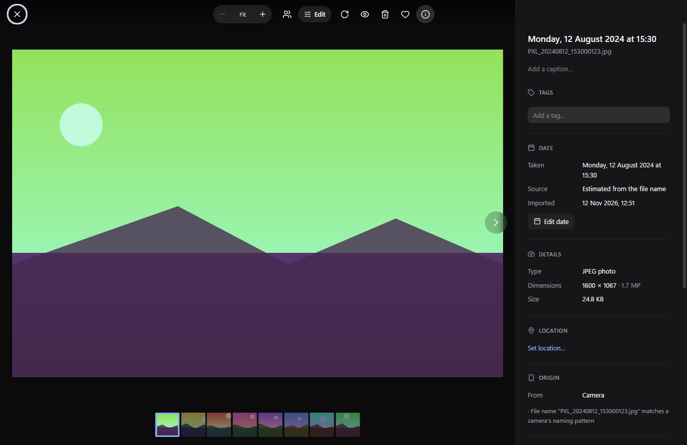
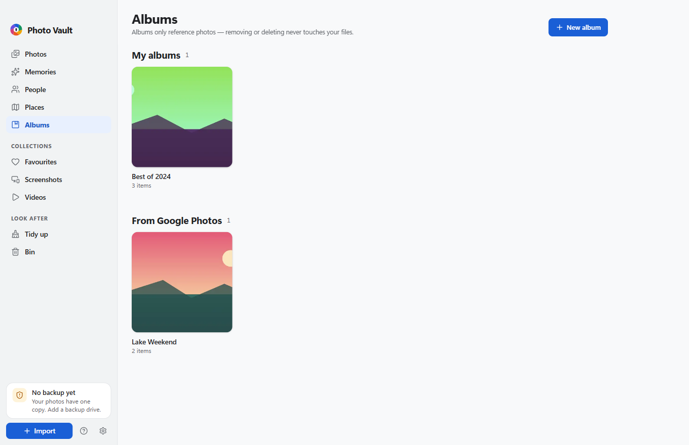

# Photo Vault

**Bring scattered photo backups into one private library you control.**

Import folders, ZIP archives and Google Takeout exports, find exact duplicates, and browse your photos by date, place or album. Originals remain ordinary files on your own drive; optional AI features run on your computer.

[**Download for Windows**](https://github.com/raullopesalves/photovault/releases/latest) · [User guide](docs/USER_GUIDE.md) · [What changed](CHANGELOG.md)



*Screenshots use generated illustrations and a disposable demo library. They contain no personal photos or real library data.*

## A short tour

- **Gather:** import folders and exports without modifying the source. SHA-256 matching recognises identical files even after renaming.
- **Organise:** browse a chronological timeline, create albums, search metadata and explore an offline map.
- **Find:** optionally enable on-device smart search, people grouping and image descriptions. Model downloads are opt-in.
- **Protect:** verify copies on backup drives, keep catalogue snapshots, and export metadata as XMP sidecars and JSON.
- **Stay in control:** use English or Portuguese, choose light or dark, and enable Offline mode to block network features.





## Try it

1. Open [the latest release](https://github.com/raullopesalves/photovault/releases/latest) and download `PhotoVault-Setup-<version>.exe`.
2. Install for your Windows user; administrator rights are not required. The build is unsigned, so Windows SmartScreen may warn on first launch. Verify the download source before proceeding.
3. Create a library in an empty folder, then import a **small copied sample** to explore the workflow. Follow the [guide](docs/USER_GUIDE.md) before moving your main collection.
4. Add a separate backup drive in Safety. Importing is not itself a backup.

Installed Windows copies can check the public GitHub releases for updates **without a GitHub token**. Uninstalling leaves your library folder intact. A portable build can be produced locally, but is not promised as an asset of every release.

**Platform status:** Windows 11 is the primary tested platform. CI also builds macOS and Linux packages; those platforms have not been verified on physical machines. The Windows installer is approximately 170 MB; optional AI models are downloaded separately.

## My contribution and technical decisions

This project demonstrates my work on the product workflow, desktop application, archive engine, recovery design and release tooling. The implementation uses Electron, React, TypeScript and SQLite, with separate core, main-process and renderer layers.

- **Files remain portable:** originals stay byte-for-byte intact; XMP sidecars and JSON keep metadata usable outside the app.
- **Imports are staged and verified:** files are copied to temporary storage before being published to the library. Hashes identify exact duplicates.
- **Heavy work leaves the UI thread:** worker threads handle whole-library computations and AI processing.
- **Privacy is architectural:** optional AI runs locally; the renderer accesses the system through a constrained preload API.
- **Recovery is exercised:** automated smoke tests cover catalogue restoration and recovery from a backup into a fresh profile.

See [technical decisions](DECISIONS.md), [library format](docs/LIBRARY_FORMAT.md) and [product context](PHOTO_VAULT_HANDOFF.md) for implementation detail. These are engineering choices, not claims of independent security certification.

## What is verified, and what remains

GitHub CI runs TypeScript checks, core tests, the Electron smoke flow, accessibility checks and cross-platform packaging. See [current check results](https://github.com/raullopesalves/photovault/actions); a passing run is not a guarantee for every library or device.

Before treating a real archive as protected, complete a backup and verify recovery. The roadmap still calls for an independent metadata check with another photo program, a first-time-user walkthrough of the guide and a listening pass with Windows Narrator. See [the 1.0 checklist](ROADMAP_1.0.md).

**Current limits:** unsigned builds; physical-device validation focused on Windows; optional AI needs model downloads and sufficient local resources. No public usage, accuracy or performance claims are made from the synthetic screenshots.

## Build and contribute

Source builds require **Node.js 24+**. End users do not need Node.js to use the Windows installer.

```sh
npm ci
npm run dev        # development application
npm run build      # production bundles in out/
npm start          # launch the built application
npm test           # archive core tests
npm run typecheck
npm run test:e2e    # synthetic library; no personal collection required
npm run test:a11y
npm run dist       # local Windows installer and portable build
```

To publish a release, update the version, commit, and run `npm run release` with an authorised GitHub CLI account. Publishing is separate from building. See [release notes](CHANGELOG.md) and the release script for the current process.

## Layout

```text
src/
  core/          archive engine – no Electron imports, fully unit-tested
    db/          node:sqlite wrapper + migrations
    media/       format sniffing, SHA-256, EXIF/XMP/QuickTime metadata, filename dates
    library/     library folder layout, safe copy/verify/never-overwrite ingest, library verification
    import/      scan → sidecars → analyse → classify → commit pipeline, ImportService (resume)
    sources/     read-only ZIP access
    takeout/     Google Takeout sidecar parsing and matching
    thumbnails/  thumbnail rendering + background queue
    repo/        read queries for the UI (timeline, pages, detail, duplicates, similar, map, FTS search)
    dating/      inferred and manual dates
    ai/          on-device CLIP embeddings (smart search)
  main/          Electron main: window, IPC handlers, pv-media:// protocol, settings,
                 worker thread (worker.ts) for whole-library computations and AI
  preload/       contextBridge API (the renderer's only access to the system)
  renderer/      React UI (Tailwind)
  shared/        types shared across the IPC boundary
tests/           Vitest suites for the core
scripts/         e2e smoke test, electron-vite launcher
```

## A library on disk

```text
<Library>/
  photovault-library.json   marker (format + id)
  README.txt
  originals/YYYY/MM/…       your photos as ordinary files
  originals/undated/…       no capture date found
  thumbnails/               regenerable cache
  database/photovault.db    SQLite catalogue
  database/backups/         automatic catalogue snapshots
  temp/                     in-flight copies (never published until verified)
  logs/                     JSON-lines logs
```

Video thumbnails and playable copies of HEVC/old videos use a bundled ffmpeg (a separate GPL program from
`ffmpeg-static`, run as a process). The smart-search model (~150 MB) and the face models (~39 MB), downloaded only if you turn those features on, live in the app's data folder
(`%APPDATA%/Photo Vault/models`), not in the library. The same goes for the automatic-descriptions model
(Florence-2-base, ~265 MB, MIT).

Photo Vault never needs the internet. The only connections are ones you start (downloading an AI model, the
detailed OpenStreetMap view, update checks), and **Settings → Offline mode** blocks all of them. Models can be
loaded from a folder (Settings → AI models) on a computer that is never online.

Importing from a phone copies its camera folders into `PhotoVault phone copies\<device>` next to the library
first (Windows only); that folder can be deleted once the import is done.

Place names (map labels, trips, search) come from [GeoNames](https://www.geonames.org) "cities1000" (CC BY 4.0), bundled
in `src/core/geo/places.json` and rebuilt with `node scripts/make-places.mjs`.

## License

[MIT](LICENSE). Bundled programs, datasets and models retain their own licences; see the format and dependency notes above.
